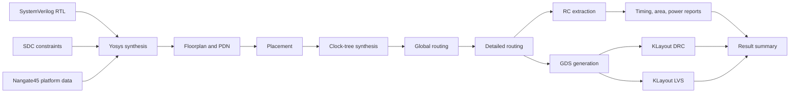

# OpenROAD 2×2 Systolic Array Physical-Design Example

## Context

The goal is to provide a small, reproducible introduction to implementing an
AI-style digital accelerator with OpenROAD. The example targets physical
design and PPA analysis rather than AI model validation or RTL functional
simulation.

The current workspace contains the OpenROAD core application source, but does
not contain OpenROAD-flow-scripts (ORFS), built binaries, Yosys, or KLayout.
The OpenROAD submodules are also not initialized. A matched ORFS container is
therefore used for the complete RTL-to-GDSII toolchain.

## Scope

The example will:

- Use the educational Nangate45 platform.
- Run an official ORFS GCD design as an environment baseline.
- Implement a small 2×2 signed integer systolic array.
- Complete synthesis, floorplanning, placement, CTS, routing, extraction, and
  final reporting.
- Produce artifacts suitable for inspection in the OpenROAD GUI.
- Generate GDS and execute the Nangate45 KLayout DRC/LVS checks supplied by
  ORFS.
- Summarize timing, area, utilization, power estimate, and physical
  verification results.

The example will not add SRAMs, AXI, DMA, floating point, quantization logic,
or a full RTL functional-verification environment. Nangate45 DRC/LVS is an
educational check and is not tapeout signoff.

## Selected approach

Use an official ORFS container and validate the setup in two steps:

1. Run the checked-in Nangate45 GCD flow.
2. Run the external `systolic2x2` design.

This separates environment failures from custom RTL or constraint failures.
It also keeps the user design outside ORFS, using ORFS's documented external
configuration interface:

```sh
make --file=<ORFS>/flow/Makefile DESIGN_CONFIG=<project>/examples/systolic2x2/config.mk
```

The existing `OpenROAD/` checkout remains unchanged and serves as source and
command reference. The container version is recorded explicitly; it is not
assumed to match that checkout.

## Repository layout

```text
chip-design/
├── OpenROAD/                         # existing source; unchanged
├── OpenROAD-flow-scripts/            # official tool/flow checkout
├── examples/
│   └── systolic2x2/
│       ├── rtl/
│       │   ├── processing_element.sv
│       │   └── systolic2x2.sv
│       ├── constraint.sdc
│       ├── config.mk
│       └── pdn.tcl
├── scripts/
│   ├── check_environment.sh
│   ├── run_gcd_baseline.sh
│   ├── run_systolic2x2.sh
│   └── summarize_results.py
└── docs/
    └── superpowers/specs/
```

Generated ORFS logs, objects, reports, and results remain in host-mounted
directories and are not mixed with hand-written RTL.

## RTL architecture

### Processing element

Each processing element has one signed 8-bit A input, one signed 8-bit B
input, registered A/B forwarding outputs, and a signed 24-bit accumulator.
On an active valid cycle it:

1. Multiplies A and B.
2. Sign-extends the 16-bit product to 24 bits.
3. Loads that product when the local `start` token is active, or otherwise
   adds it to the accumulator.
4. Registers A toward the right and B toward the bottom.

Reset is synchronous and clears forwarding registers, control state, and the
accumulator. Each processing element forwards `valid`, `start`, and `last`
tokens with its A/B data.

### Array

The top level instantiates four processing elements in a 2×2 grid. A values
enter from the left and move right; B values enter from the top and move down.
On every `valid_in` cycle, the two left-edge A values represent one matrix
column for the current inner-dimension index, and the two top-edge B values
represent one matrix row. `start` marks the first inner-dimension term and
`last` marks the final term. For a fixed 2×2 matrix multiplication, the caller
therefore presents two consecutive valid cycles, with `start` asserted on the
first and `last` on the second.

Control tokens follow the same wavefront as data. Each PE updates only when its
local valid token arrives. A top-level `done` pulse is generated when the
bottom-right PE consumes its local `last` token; by then all four signed
24-bit accumulated outputs are stable.

The design has one clock domain and no generated clocks, memories, macros, or
black boxes. These boundaries keep the first physical-design example focused
on standard-cell implementation.

## Constraints and platform configuration

- Platform: `nangate45`.
- Initial clock period: 10 ns (100 MHz).
- One clock is defined on the top-level clock port.
- Input and output delay constraints are defined relative to that clock.
- Die/core sizing starts from ORFS automatic sizing with conservative core
  utilization.
- The local PDN configuration uses a grid pitch suitable for a very small
  block, based on the same need addressed by the ORFS Nangate45 GCD example.
- Platform LEF, Liberty, cell GDS/CDL, routing rules, and RC models come from
  ORFS rather than being copied into the user example.

After the flow passes at 10 ns, clock tightening is a separate experiment, not
a condition for initial success.

## Data flow



## Outputs and acceptance criteria

The GCD baseline must complete before the custom design is attempted.

The custom run is accepted when:

- Yosys parses and elaborates the intended top module.
- There are no unresolved modules, unintended latches, or combinational loops.
- The PE and multiply-accumulate structures are not optimized away.
- Floorplan, placement, CTS, global routing, and detailed routing complete.
- The final design has no unrouted nets.
- Netlist, SDC, DEF, ODB, SPEF, GDS, logs, reports, and metrics are retained.
- The final ODB can be opened with the OpenROAD GUI.
- KLayout DRC and LVS both execute and their pass/fail counts are reported.
- A summary records tool versions, run command, cell count, area, utilization,
  WNS, TNS, clock skew, estimated power, route violations, DRC count, and LVS
  status.

Generating GDS does not imply signoff success. Any DRC, LVS, routing, or timing
violation remains visible and causes the summary to state "flow completed,
checks failed" rather than reporting an unconditional pass.

## Power interpretation

The initial power result uses the activity assumptions available to the
default ORFS analysis. It is an estimate for flow comparison, not a workload
power claim. A later extension may supply VCD/SAIF activity from functional
simulation, but that is outside this design.

## Error handling

- The preflight script checks Docker access, disk space, the ORFS revision,
  image availability, and required host paths.
- It records the container image digest and Yosys, OpenROAD, and KLayout
  versions.
- A failed GCD baseline stops the workflow before custom design execution.
- Run scripts fail on command errors and identify the failed stage and
  relevant log directory.
- Congestion is addressed first by lowering utilization or enlarging the
  floorplan, not by weakening design rules.
- Timing failure preserves reports for diagnosis; the initial remedy is to
  determine whether constraints or logic depth caused the failure.
- GUI launch is separate from batch completion because host X11 availability
  must not invalidate an otherwise successful physical-design run.

## Verification strategy

### Environment

Verify container execution and record exact source/image/tool versions.

### Baseline

Run the official ORFS Nangate45 GCD design through the required stages and
check its expected artifacts.

### RTL and flow structure

Use Yosys elaboration and synthesis reports to verify the top module,
hierarchy, inferred sequential elements, and retained arithmetic. Treat
unresolved references, unintended latches, and loops as failures.

### Physical implementation

Check stage return codes, unrouted-net status, timing reports, route DRC,
generated physical artifacts, KLayout DRC, and LVS.

### Reproducibility

Delete only generated output for the custom design and rerun from the pinned
ORFS revision and recorded container image. Compare the presence and status of
key outputs and regenerate the summary.

## Future extensions

Possible follow-on work includes a Verilator testbench, VCD/SAIF-driven power,
larger arrays, SRAM macros, alternative clock targets, SKY130 migration, and
PPA sweeps. None of these are prerequisites for the first example.
